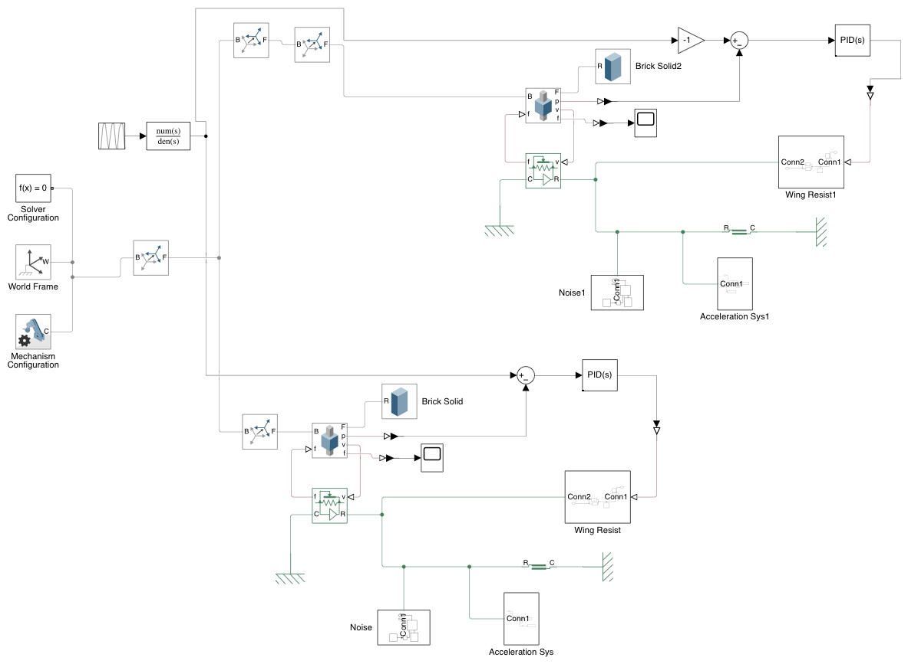
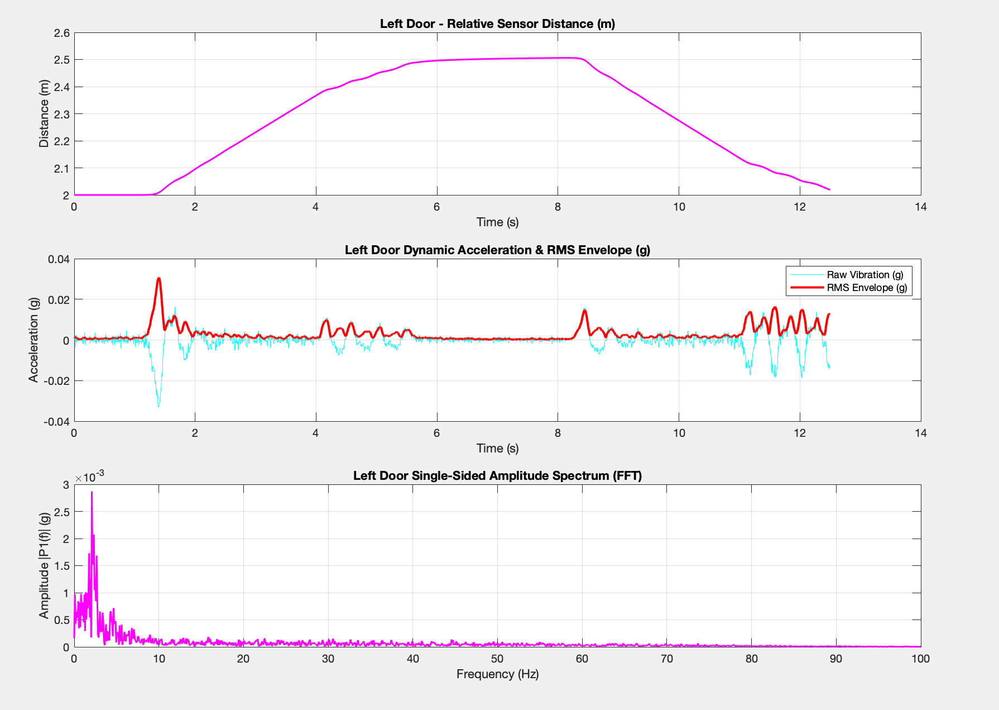

# Platform Screen Doors — Simscape Multibody Simulation Study

**Author:** Boran Aras — Mechatronics Engineering, Yıldız Technical University  
**Tools:** MATLAB, Simulink, Simscape Multibody

---

## Overview

A physics-based simulation study of the opening and closing motion of two sliding platform screen door leaves. The model combines mechanical dynamics, friction, band-limited force disturbances, and two independent PID position-control loops.

### Model Components
* **Mechanical model:** Two sliding door leaves represented with point-mass inertia and prismatic joints, coupled to translational spring, damper, mass, and friction elements.
* **Position control:** Filtered motion references driving two separate PID loops for opposite-direction door movements.
* **Disturbance modeling:** Band-limited random force inputs applied to observe mechanical vibration responses.
* **Signal processing (`matlab/analyze_simscape_telemetry.m`):** Converts simulated accelerations to g-units, applies distance-dependent signal weighting and superposition, and plots moving RMS envelopes and single-sided FFT spectra.

---

## Model Architecture


## Simulation Output (Distance, Acceleration, Moving RMS & FFT)


---

## Repository Contents

```text
.
├── simscape/
│   └── platform_screen_doors_multibody.slx   # Simscape Multibody & PID control model
├── matlab/
│   └── analyze_simscape_telemetry.m          # Moving RMS, FFT and position-weighted plotting script
├── figures/
│   ├── simscape_model_architecture.png
│   └── simscape_simulation_output.png
└── README.md
```

## How to Run
1. Open `simscape/platform_screen_doors_multibody.slx` in MATLAB / Simulink (requires Simscape & Simscape Multibody) and run the simulation.
2. Run `matlab/analyze_simscape_telemetry.m` to generate the distance, dynamic acceleration, moving RMS, and FFT plots from the simulation workspace output (`out`).
