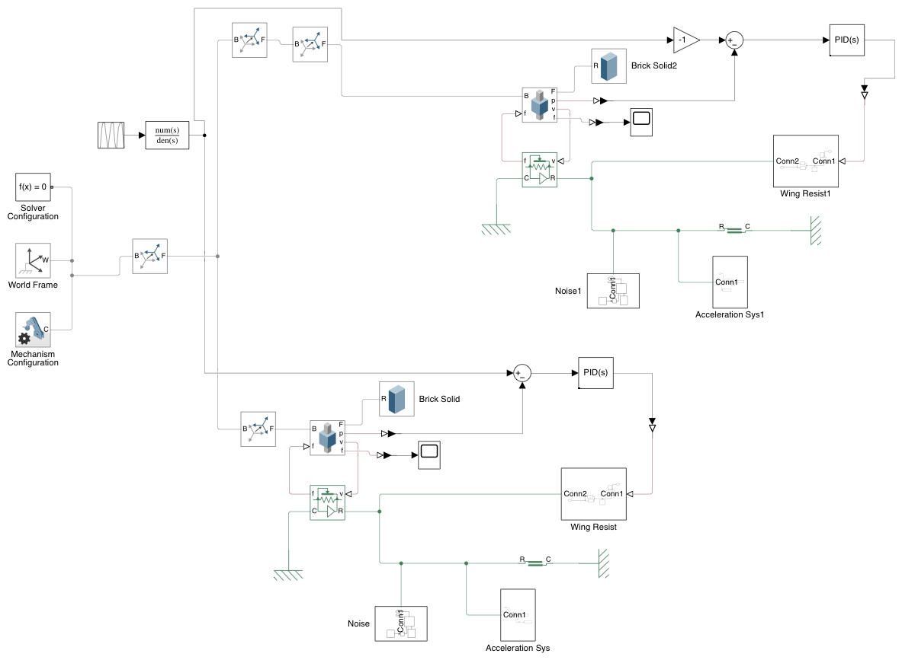
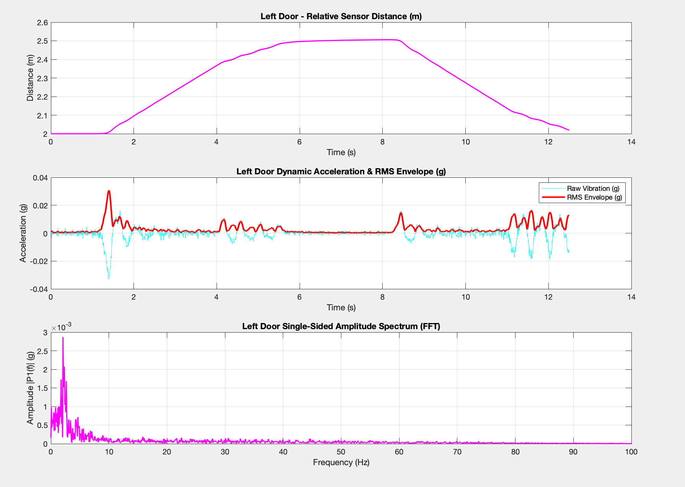

# Platform Screen Doors — Simscape Multibody Simulation Study

**Author:** Boran Aras — Mechatronics Engineering, Yıldız Technical University  
**Tools:** MATLAB, Simulink, Simscape Multibody

---

## Overview

A physics-based simulation study of the opening and closing motion of two sliding platform screen door leaves. The model combines mechanical dynamics, friction, band-limited force disturbances, and two independent PID position-control loops.

### Model Components
* **Mechanical model:** Two sliding door leaves represented with point-mass inertia and prismatic joints, coupled to translational spring, damper, mass, and friction elements.
* **Position control:** Filtered motion references driving two separate PID loops for opposite-direction door movements.
* **Disturbance modeling:** Band-limited random force inputs applied to observe mechanical vibration responses during motion.
* **Signal processing (`matlab/analyze_simscape_telemetry.m`):** Converts simulated accelerations to g-units, applies exploratory distance-dependent signal weighting and superposition, and generates 50 ms moving RMS envelopes and single-sided FFT spectra.

---

## Model Architecture


## Simulation Output (Distance, Acceleration, Moving RMS & FFT)


---

## Model Scope, Assumptions & Limitations

* **1-DOF Rigid-Body Simplification:** Each sliding leaf is modeled along a single translational (prismatic) degree of freedom without structural beam flexibility or 3D roller-track contact geometry.
* **Exploratory Signal Weighting:** The distance-dependent attenuation coefficients (`0.30–1.00` for the right leaf and `0.10–0.25` for the left leaf) represent a simplified linear proximity weighting rather than a finite-element structural wave propagation model.
* **Variable-Step vs. Uniform FFT Note:** The post-processing script estimates an average sampling rate (`1 / mean(diff(t))`) for quick spectral inspection; for strict frequency-domain accuracy under variable-step solvers, resampling to a uniform time grid (or running a fixed-step solver) is recommended.
* **Intended Purpose:** Built as an undergraduate mechatronics modeling study to explore actuator-door dynamics, PID tracking, and vibration post-processing before experimental calibration against physical hardware.

---

## Repository Contents

```text
.
├── simscape/
│   └── platform_screen_doors_multibody.slx   # Simscape Multibody & PID control model
├── matlab/
│   └── analyze_simscape_telemetry.m          # Moving RMS, FFT and position-weighted plotting script
├── figures/
│   ├── simscape_model_architecture.png
│   └── simscape_simulation_output.png
└── README.md
```

## How to Run
1. Open `simscape/platform_screen_doors_multibody.slx` in MATLAB / Simulink (requires Simscape & Simscape Multibody) and run the simulation.
2. Run `matlab/analyze_simscape_telemetry.m` to generate the distance, dynamic acceleration, moving RMS, and FFT plots from the simulation workspace output (`out`).
   *(Note: Simulink workspace output variable names such as `out.zaman_verisi` and `out.sim_position_sag` are preserved in the script to stay compatible with the `.slx` file.)*
